# Отчет по развертыванию домашнего SOC-стенда и расследованию инцидента безопасности

## 1. Введение и цели лаборатории
В рамках развертывания домашнего SOC-стенда (Wazuh SIEM + Windows 10 Endpoint) была проведена практическая симуляция попытки несанкционированного доступа по протоколу SMB. Цель работы — проверить корректность сбора логов безопасности, работу правил корреляции Wazuh и закрепить навыки триажа инцидентов уровня L1.

---

## 2. Архитектура стенда
* **SIEM-сервер:** Ubuntu Server (`10.0.2.3`), Wazuh v4.14.
* **Целевой хост (Endpoint):** Windows 10 (`win10lab`, IP: `10.0.2.15`, Agent ID: `001`).

---

## 3. Этапы развертывания стенда и симуляции атак

### Фаза 0. Подготовка сетевого окружения
Перед установкой SIEM-системы и агентов была настроена связь между виртуальными машинами и разрешено прохождение пингов через брандмауэр Windows:
```cmd
netsh advfirewall firewall add rule name="Allow ICMP" protocol=icmpv4:any,any dir=in action=allow
```
> 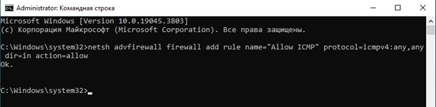

---

### Фаза 1. Развертывание Wazuh SIEM на Ubuntu Linux
1. **Подготовка системы и утилит:** Обновление пакетов и установка `curl`.
   > 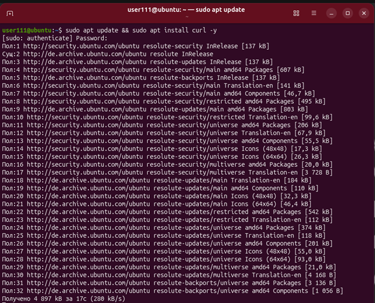
   > 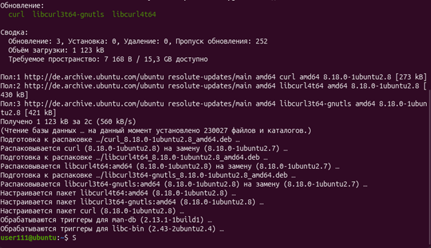

2. **Настройка файла подкачки (Swap):** Выделение 4 ГБ виртуальной памяти для стабильности.
   > 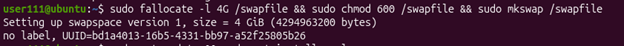
   > 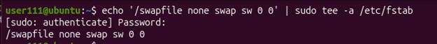

3. **Установка SIEM-сервера:** Запуск официального скрипта Wazuh.
   > 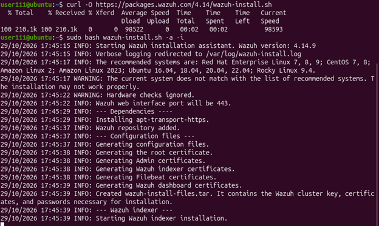
   > 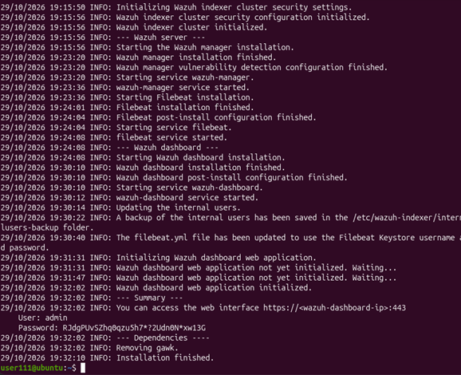

4. **Проверка служб и доступ к веб-интерфейсу:** Проверка активности служб и IP-адреса.
   > 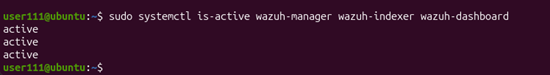
   > 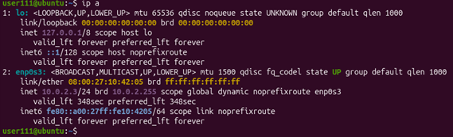
   > 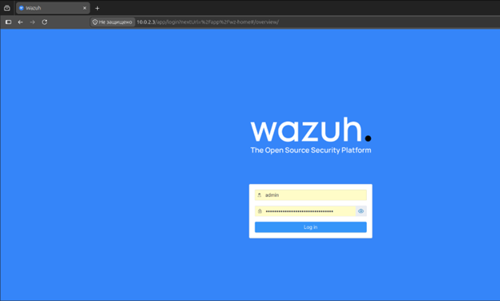
   > 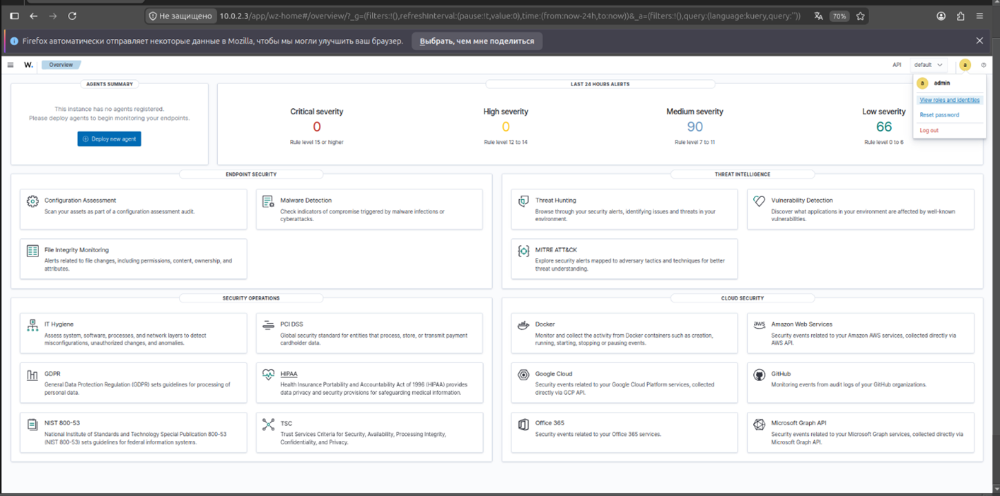

---

### Фаза 2. Подключение Windows 10 в качестве эндпоинта
1. **Генерация инструкций:** Создание нового агента для Windows.
   > 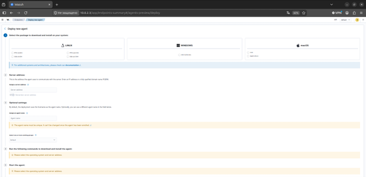
   > 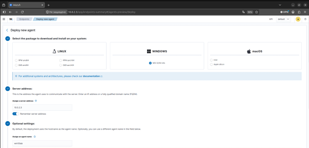
   > 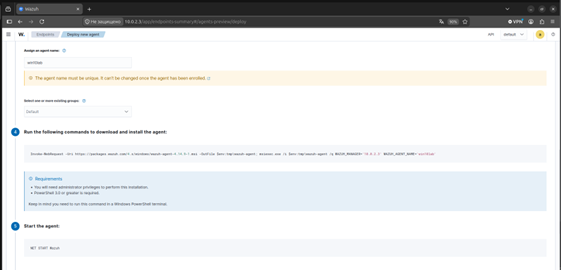

2. **Установка агента:** Выполнение скрипта на хосте-жертве.
   > 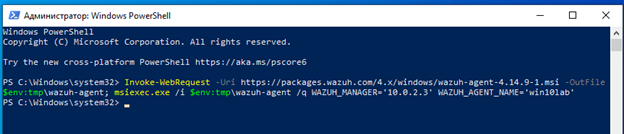
   > 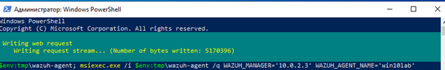
   > 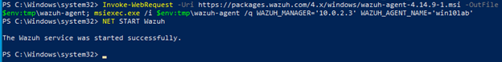

3. **Верификация в SIEM:** Проверка статуса хоста в панели.
   > 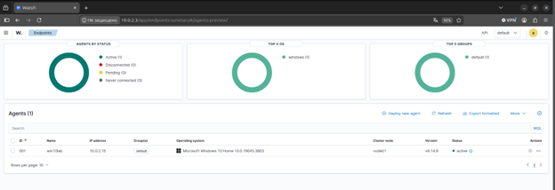
   > 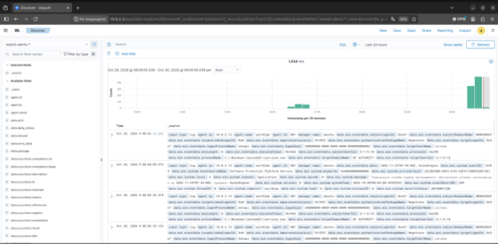

---

### Фаза 3. Симуляция атаки (Red Teaming) и Триаж (Blue Teaming)
1. **Генерация инцидента:** Запуск брутфорса через PowerShell.
   ```powershell
   for ($i=1; $i -le 5; $i++) { net use \\127.0.0.1\c$ "BadPassword$i" /user:"FakeAdmin" }
   ```
   > 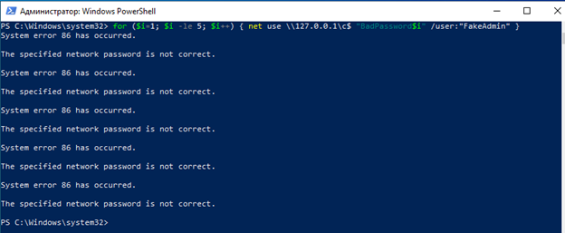

2. **Детектирование в SIEM:** Появление алертов высокой важности.
   > 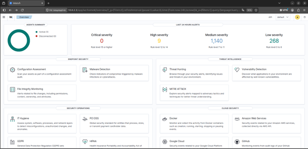
   > 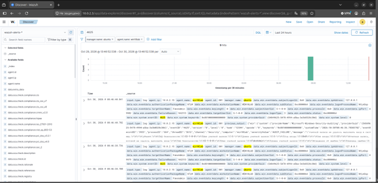

---

### Фаза 4. Глубокий анализ лога инцидента (JSON)
Детальный разбор структуры алерта во вкладке JSON:
   > 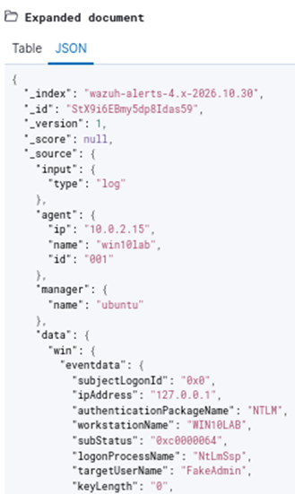

- **Идентификация агента (`agent`):**
  * `ip: "10.0.2.15"` — IP целевой машины (`win10lab`).
  * `name: "win10lab"` — имя хоста под ID `001`.
   > 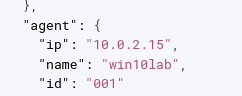

- **Параметры события (`eventdata`):**
  * `ipAddress: "127.0.0.1"` — источник запроса (loopback).
  * `targetUserName: "FakeAdmin"` — целевая учетная запись.
  * `logonType: "3"` — сетевой вход (*Network Logon*).
   > 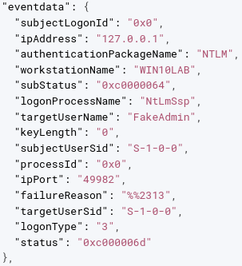

- **Системные метаданные (`system`):**
  * `eventID: "4625"` — аудит неудачного входа.
   > 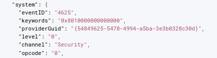

- **Системное сообщение (`message`):**
  * `systemTime` — метка времени.
  * `severityValue` — `AUDIT_FAILURE`.
  * Текст ошибки аутентификации.
   > 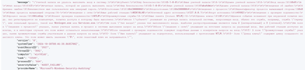

---

## 5. Выводы и планы развития (Roadmap)
1. **Результат:** Инфраструктура развернута успешно, связка Windows Event Log -> Wazuh Agent -> Wazuh Server функционирует корректно. Навыки базового триажа инцидентов L1 закреплены.
2. **Планы (Фаза 2):** 
   * Интеграция атакующего хоста на базе **Kali Linux** для проведения полноценных сетевых атак.
   * Настройка **SOAR**-платформы для автоматического реагирования на инциденты и генерации тикетов.
